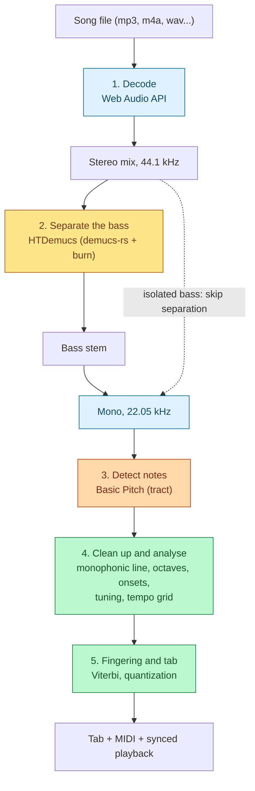
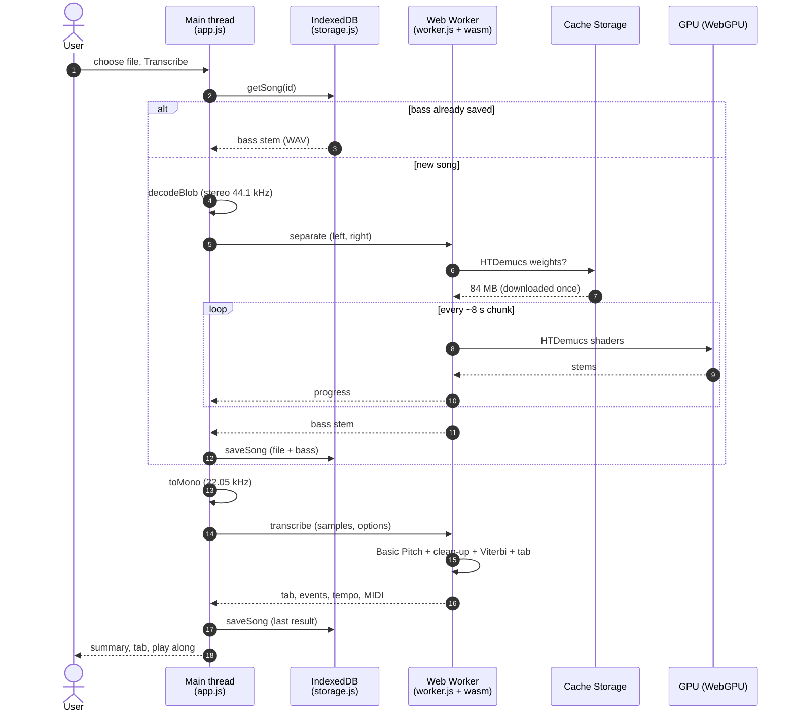
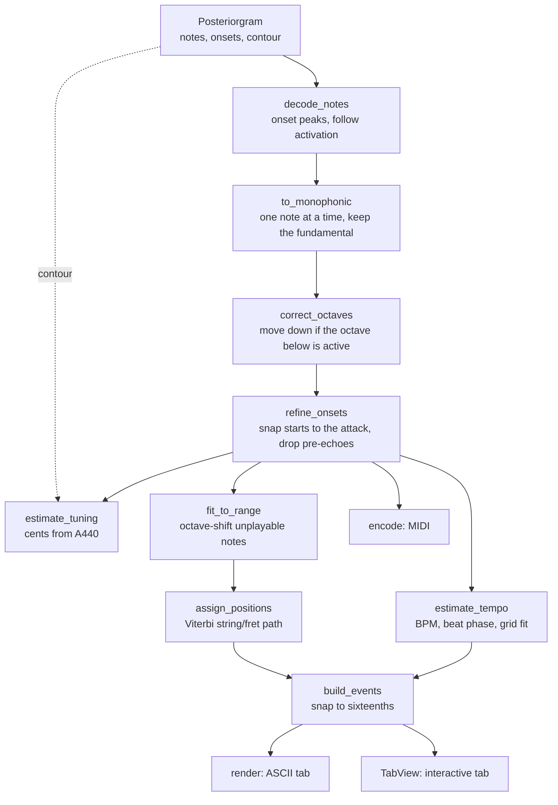

# Architecture

How bassline-to-tab turns a song into bass tablature, stage by stage: what
each stage does, which file and functions implement it, and which parts are
third-party versus written for this project.



Colours: blue runs in the browser's own audio engine, yellow on the GPU,
orange on the CPU inside WebAssembly, green is this project's own logic.

Two pre-trained neural networks do the perception (what is bass, which pitch
sounds when). Everything that turns their output into a playable tab is
specific to this project.

## Runtime layout

Everything runs in the browser, on the user's device. GitHub Pages only serves
static files; there is no backend.

| Thread | Code | Responsibilities |
| --- | --- | --- |
| Main thread | `web/app.js`, `web/tab-view.js`, `web/storage.js` | UI, audio decoding and resampling (the Web Audio API only exists here), song history, playback and the tab cursor. |
| Web Worker | `web/worker.js` + `pkg/bassline_web.js` / `.wasm` | Downloads and caches the Demucs weights, runs separation and transcription so the page stays responsive. |

One transcription, end to end:



On a song already in the history, steps 3–12 are skipped: the saved bass stem
is decoded instead, so changing settings and transcribing again takes
seconds.

The Rust code lives in two crates:

- `crates/core` (`bassline-core`): platform-agnostic transcription. It takes
  mono samples at 22.05 kHz and returns notes, tempo, tuning, tab and MIDI.
  Tested natively with `cargo test`.
- `crates/web` (`bassline-web`): thin `wasm-bindgen` layer exposing
  `separate_bass` and `transcribe` to JavaScript.

The worker is restarted after any error (`startWorker` in `app.js`): a Rust
panic or a lost GPU device leaves the WebAssembly instance unusable.

## 1. Decode

| | |
| --- | --- |
| Code | `web/app.js`: `decodeBlob`, `toMono` |
| Third-party | Web Audio API (`decodeAudioData`, `OfflineAudioContext`), built into the browser |

The file is decoded to stereo PCM at 44.1 kHz for separation. After
separation, `toMono` downmixes the bass to mono and resamples it to 22.05 kHz
for Basic Pitch, using the browser's resampler.

## 2. Separate the bass

| | |
| --- | --- |
| Code | `crates/web/src/lib.rs`: `separate_bass`, `webgpu_device`, `ChunkProgress`; `web/worker.js`: `loadWeights`, `handleSeparate` |
| Third-party | HTDemucs weights (Meta, MIT), [demucs-rs](https://github.com/nikhilunni/demucs-rs) `demucs-core` (Apache-2.0), [burn](https://burn.dev) with `cubecl-wgpu`, WebGPU |

**Model.** HTDemucs (Hybrid Transformer Demucs, v4) separates a mix into
drums, bass, vocals and "other". It has two encoder–decoder branches, one on
the raw waveform (good at attacks) and one on the spectrogram (good at
sustained pitch and timbre), joined by a cross-domain Transformer. It
processes ~7.8 s segments; longer audio is split into overlapping chunks and
recombined with a triangular cross-fade.

**Runtime.** `demucs-core` is a Rust implementation of the model on the burn
deep-learning framework. burn's `cubecl-wgpu` backend compiles each operation
to WGSL compute shaders and runs them on the GPU through WebGPU. Kernel
fusion is on.

**Own code.** `separate_bass` initialises WebGPU once, loads the weights,
forwards per-chunk progress to JavaScript and returns only the bass stem.
`loadWeights` downloads the 84 MB safetensors file from Hugging Face with
progress and caches it in Cache Storage.

**Autotune is off.** burn can benchmark kernel variants and keep the fastest
("autotune"). With HTDemucs some candidates exceed the GPU watchdog: Apple
mobile GPUs hang, and on macOS Metal killed a `ConvTranspose2d` benchmark with
a GPU timeout, after which reading the result panicked. The `autotune` cargo
feature is kept for experiments only; see issue #2 for speed work.

## 3. Detect notes

| | |
| --- | --- |
| Code | `crates/core/src/model.rs`: `BasicPitch::load`, `BasicPitch::run_with_progress`, `crossfade_weight`, `frame_time`; `crates/core/src/notes.rs`: `decode_notes`, `infer_onsets`, `onset_peaks` |
| Third-party | Basic Pitch model (Spotify, Apache-2.0, ONNX, 230 KB, embedded), [tract](https://github.com/sonos/tract) ONNX runtime |

**Model.** Basic Pitch takes ~2 s windows of mono audio at 22.05 kHz and
outputs three posteriorgrams (time × pitch "heat maps", ~86 frames/s):

- `notes`: probability that each of 88 piano pitches is sounding;
- `onsets`: probability that a note starts;
- `contour`: fine pitch, 3 bins per semitone.

tract runs it on the CPU inside WebAssembly (`simd128` enabled).

**Windowing (own change).** Consecutive windows overlap by 30 frames. Basic
Pitch cuts each window in the middle of the overlap, which leaves a step in
the activations at every window boundary and creates fake onsets there.
`run_with_progress` cross-fades the overlapping frames instead
(`crossfade_weight`). `frame_time` maps output frames to seconds.

```
                 window k (172 frames, ~2 s)
  ...============================================\
                                       /============================================...
                                       |<- 30 ->|   overlap
  Basic Pitch:   keep k up to the middle of the overlap, then switch to k+1
                 -> a step in the activations at every boundary
  bassline-to-tab: weights fade k from 1 to 0 and k+1 from 0 to 1 across the
                 overlap (5 edge frames ignored), always summing to 1
```

**Note decoding (port).** `decode_notes` ports Basic Pitch's
`output_to_notes_polyphonic`: `infer_onsets` adds onsets where note
activations jump, `onset_peaks` finds local maxima above the threshold, and
each onset is followed forward while the note activation stays above the
frame threshold. Basic Pitch's "melodia trick" (notes without an onset) is
left out because on bass it mostly added noise.

## 4. Clean up and analyse (own logic)




| Step | Code | What it does |
| --- | --- | --- |
| Monophonic line | `notes.rs`: `to_monophonic`, `drop_pre_echoes` | The bass plays one note at a time. Simultaneous notes are treated as harmonics and the lowest reasonably strong one wins; overlapping notes are cut. Weak notes running straight into a stronger one of the same pitch are dropped. |
| Octave correction | `notes.rs`: `correct_octaves` | The model often reports the 2nd harmonic instead of the fundamental. A note moves down an octave when the activation one octave below is at least 0.38× its own. |
| Onset refinement | `onsets.rs`: `refine_onsets`, `energy_envelope` | The model reports low notes late (up to ~50 ms on low E). Each start moves to the steepest rise of the short-time energy within −90/+30 ms. Notes with no attack of their own that are short, weak and run into the same pitch are dropped as pre-echoes. |
| Recording tuning | `analysis.rs`: `estimate_tuning` | For every note frame, the `contour` peak near the note (bin `3k+1` is the in-tune centre) is refined with parabolic interpolation; the weighted mean offset gives the deviation from A440 in cents. Accurate to ~10 cents. |
| Tempo and grid | `analysis.rs`: `estimate_tempo` | See below. |

**Tempo and grid.** `estimate_tempo` runs three steps:

1. `onset_envelope` turns note starts into a 200 Hz pulse train weighted by
   amplitude; `estimate_bpm` autocorrelates it over 60–200 BPM with a
   log-normal prior centred on 120 BPM to avoid half/double-tempo errors.
2. `first_beat`, `best_phase` and `phase_score` choose the beat phase that puts
   the strongest notes on beats.
3. `refine_grid` fits `time = origin + index × sixteenth` by weighted least
   squares (`GridFit::add`, `GridFit::solve`): first tracking note by note so
   a small tempo error cannot accumulate into wrong indices, then refitting
   globally. The origin is snapped back to the beat afterwards.

A user-provided BPM skips steps 1 and 3.

**Calibration.** The octave ratio and the pre-echo rules were tuned on a real
Demucs bass stem against an independent pYIN pitch track (librosa). On that
recording: notes 412 → 693, exact-pitch agreement ~74% → 82%, octave-up
errors 114 → 30, coverage of voiced frames 39% → 75%. More recordings are
needed to confirm these settings generalise.

## 5. Fingering and tab (own logic)

| Step | Code | What it does |
| --- | --- | --- |
| Tunings | `tuning.rs`: `Tuning::from_spec`, `parse_pitch`, `pitch_name` | Presets (standard, Drop D, half step down, D standard, 5 and 6 strings) or explicit notes. |
| Range fit | `fretboard.rs`: `fit_to_range` | Notes the instrument cannot play are shifted by octaves (the page warns). |
| Fingering | `fretboard.rs`: `assign_positions`, `position_cost`, `transition_cost` | Viterbi (dynamic programming) over all notes at once: picks the string/fret path with the lowest total cost. Costs favour low frets, staying within a 4-fret hand span and few string crossings; frets above 12 are penalised. `FingeringStyle` picks the weights: "open position" (default) or "lower strings", which adds a cost per string index so lines stay on the E/A strings higher up the neck. The pipeline fingers and renders the tab once per style (`Transcription::fingerings`); the page stores both and toggles between them. |
| Quantization | `tab.rs`: `quantize_step`, `build_events` | Snaps each note to the nearest sixteenth of the tempo grid (4/4). |
| Text tab | `tab.rs`: `render` | ASCII tab for the `.txt` download. |
| MIDI | `midi.rs`: `encode` | Standard MIDI file; the [midly](https://crates.io/crates/midly) crate writes the binary format. |
| Orchestration | `pipeline.rs`: `transcribe` | Runs stages 3–5 in order and collects warnings. |

**Viterbi, by example.** For E2 → G2 → A2 in standard tuning every note has
several positions, each with its own cost (`position_cost`); moving between
two positions adds `transition_cost`. Viterbi keeps, for every position of
every note, the cheapest path that reaches it, then walks back from the
cheapest final position:

```
  note         E2 (MIDI 40)        G2 (MIDI 43)        A2 (MIDI 45)
  candidates   E string fret 12    E 15                E 17
  (position    A 7                 A 10                A 12
   cost)       D 2   (0.16) ──┐    D 5                 D 7
                              └──► G 0   (0.30) ─────► G 2   (0.16)
  transitions       D2 → G0: one string crossed, open string: 0.30
                    G0 → G2: from an open string, no hand shift: 0.00
  total             0.16 + 0.30 + 0.30 + 0.00 + 0.16 = 0.92  (cheapest path)
```

A greedy choice only looks at the previous note, so once the hand drifts up
the neck it stays there; Viterbi compares whole paths and returns to the low
position as soon as that is cheaper overall.

## Web app (own logic)

| Part | Code | What it does |
| --- | --- | --- |
| Interactive tab | `web/tab-view.js`: `TabView` | Lays bars out to fit the container width (no horizontal scrolling), shrinks the font on narrow screens, highlights the current sixteenth from the audio time, seeks on click. |
| Playback | `web/app.js`: `setPlayerSources`, `selectSource`, `followPlayback` | One `<audio>` element switching between the bass stem and the original mix; a `requestAnimationFrame` loop drives the cursor. |
| History | `web/storage.js`: `saveSong`, `getSong`, `listSongs`, `deleteSong` | IndexedDB records with the original file, the bass stem (16-bit mono WAV) and the last transcription, so re-transcribing reuses the bass. |
| Flow | `web/app.js`: `run`, `prepareSource` | Decode → separate (or reuse the saved bass) → resample → transcribe → save → show. |

## Third-party versus own

| Third-party | Own |
| --- | --- |
| HTDemucs weights (Meta) | Separation wrapper, weight caching, worker |
| demucs-rs / demucs-core, burn, cubecl-wgpu | Basic Pitch windowing with cross-fade |
| Basic Pitch model (Spotify) | Note decoding port and its changes |
| tract | Monophonic line, octave correction, onset refinement |
| midly | Tuning estimate, tempo and grid fitting |
| wasm-bindgen, js-sys, serde | Viterbi fingering, quantization, ASCII tab |
| Web Audio API, WebGPU, IndexedDB | Interactive tab, playback sync, history, UI |
| Tailwind (CDN) | Build script, CI, end-to-end tests |

## Design decisions

- **Rust instead of Python.** The `basic-pitch` Python package needs Python
  ≤ 3.11 and TensorFlow < 2.15 on Linux, while its ONNX model runs in pure Rust
  with tract. Rust compiles to WebAssembly, so the same core runs natively in
  tests and in the browser.
- **Client-side only.** No server to pay for or keep running; audio never
  leaves the device. The cost is speed: separation depends on the device GPU.
- **No autotune.** See stage 2.
- **Tests.** `cargo test -p bassline-core` runs unit tests and an end-to-end
  test of the real model on a synthetic riff (`crates/core/tests/pipeline.rs`).
  `web/e2e` runs the built site in headless Chromium (transcription, layout,
  seeking, history). Separation is not covered by CI because the runners have
  no GPU.
